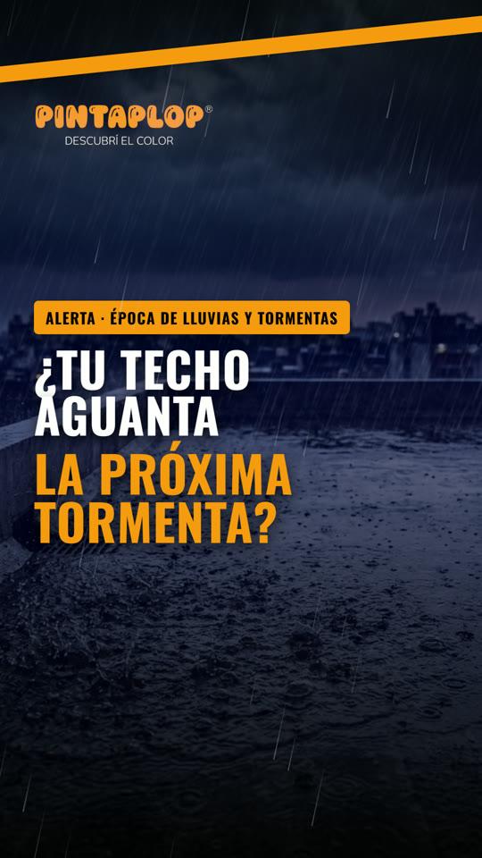
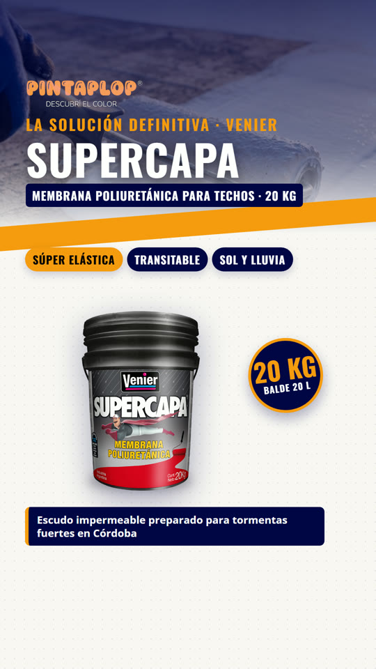
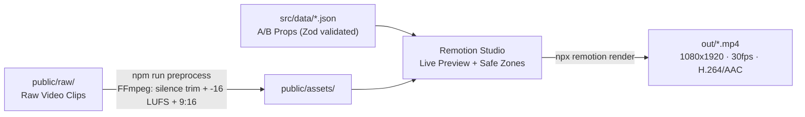

# 🎬 Video Ads Studio — Remotion + FFmpeg


A **Video-as-Code** programmatic advertising engine built with **Remotion v4, React, TypeScript, Zod, and FFmpeg**.  
Designed to produce high-converting vertical ads (`1080×1920`, `30 fps`, `15 s`) for **Instagram Reels, TikTok, and Meta Ads** by decoupling motion design from campaign copy — enabling instant **A/B creative testing** from JSON configs.

> **Case study included:** **PINTAPLOP®** (paint & waterproofing retail brand in Córdoba, Argentina). Contact details and pricing in this public repository are sanitized demo placeholders.

---

## Visual Preview (Rendered from Code)

<p align="center">
  
  
  
</p>

---

## Architecture & Pipeline



### Key Engineering Highlights
- **Data-Driven A/B Testing (`Zod` + `JSON`):** Every headline, hook, benefit card, optional price badge, color token (`@remotion/zod-types`), and video background is strictly validated and live-editable in Remotion Studio's sidebar.
- **Reels / TikTok / Meta Ads Safe-Zone System:** All typography, packshots, and CTAs sit inside verified safe margins (`top: 220px`, `bottom: 340px`, `right: 140px`), with an interactive `mostrarZonaSegura` toggle overlay in Studio.
- **Frame-Accurate Performance Architecture:** `useCurrentFrame()` is isolated inside leaf components, using inline `interpolate()` with `Easing.spring()` / `Easing.bezier()` and `@remotion/transitions` (`<TransitionSeries>`).
- **Deterministic Procedural Storm Effects:** Custom rain streaks and lightning flash overlays (`src/components/StormEffects.tsx`) computed deterministically per frame (zero `Math.random()`, 100% reproducible across multi-threaded Chromium workers).
- **Automated FFmpeg Media Pipeline (`scripts/preprocess-raw.mjs`):** Cuts dead air (`silenceremove`), masters audio to **`-16 LUFS`** (`loudnorm`), and center-crops raw clips to `1080×1920` `30 fps`.

---

## Included Compositions

| Composition ID | Folder in Studio | Campaign Focus | Config File |
| :--- | :--- | :--- | :--- |
| `PintaPlopReelA` | `PintaPlop-Reels-15s` | Home segment · Free delivery hook | `src/data/variante-a-hogar.json` |
| `PintaPlopReelB` | `PintaPlop-Reels-15s` | Contractors / Fast delivery variant | `src/data/variante-b-obra.json` |
| `PintaPlopVenierTormentas` | `Campanas-Producto` | Storm season waterproofing ad (rain + lightning FX) | `src/data/venier-supercapa-tormentas.json` |

---

## Project Structure

```text
├── docs/previews/              # Rendered preview frames for README
├── public/
│   ├── raw/                    # Drop raw .mp4/.mov clips here (gitignored)
│   └── assets/                 # Brand logos, packshots, fonts, normalized audio
├── scripts/
│   └── preprocess-raw.mjs      # Cross-platform FFmpeg preprocessing script
├── src/
│   ├── components/             # SafeZoneOverlay, BackgroundAudio, StormEffects
│   ├── data/                   # Editable A/B campaign JSON files
│   ├── scenes/                 # Modular 0-3s Hook, Showcase, Benefits & CTA scenes
│   ├── adConfig.ts             # Zod schema for general A/B ads
│   ├── venierStormConfig.ts    # Zod schema for storm product campaign
│   ├── PintaPlopAd.tsx         # General A/B master composition
│   ├── VenierStormAd.tsx       # Storm campaign master composition
│   └── Root.tsx                # Remotion composition registry
└── remotion.config.ts
```

---

## Quick Start

### Requirements
- **Node.js** `20+`
- **FFmpeg** installed on `PATH` *(optional — only needed if preprocessing raw clips via `npm run preprocess`)*

### 1. Install dependencies
```bash
npm install
```

### 2. Launch Remotion Studio (Live Preview)
```bash
npm run dev
```
Open `http://localhost:3000`, pick any composition on the left sidebar, and edit copy, colors, rain intensity, or toggle `mostrarZonaSegura` in real time.

### 3. (Optional) Preprocess raw vertical/horizontal clips
Drop any `.mp4` / `.mov` files into `public/raw/` and run:
```bash
npm run preprocess
```
Outputs normalized `-16 LUFS`, `1080×1920` `30 fps` clips into `public/assets/clips/`.

### 4. Render final MP4s
```bash
npm run typecheck
npm run render:a
npm run render:b
npm run render:storm
```

Or pass custom A/B props JSON at render time:
```bash
npx remotion render PintaPlopReelA out/custom-test.mp4 --props=./src/data/variante-a-hogar.json
```

---

## License

MIT © 2026 Maximo Leandro Young
